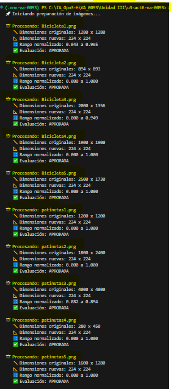
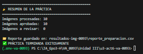
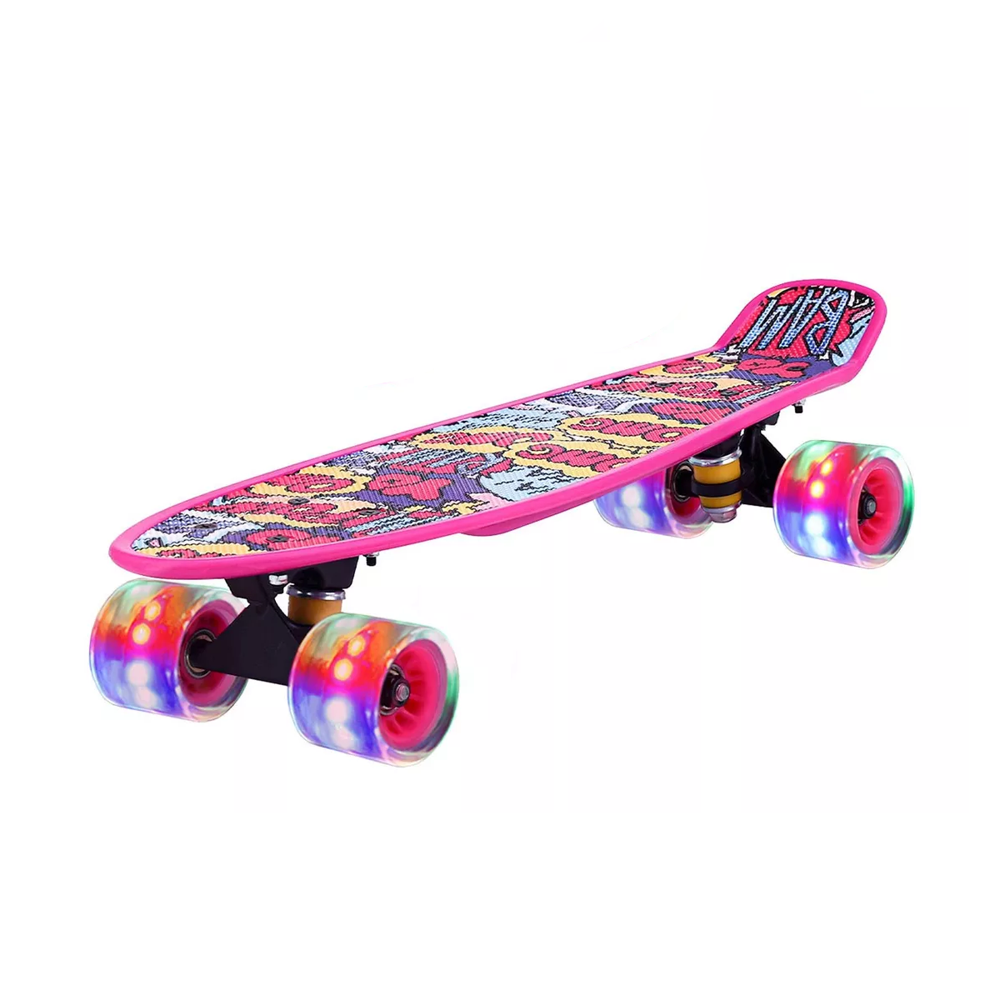
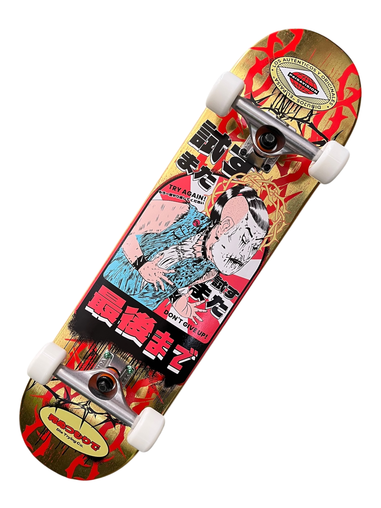
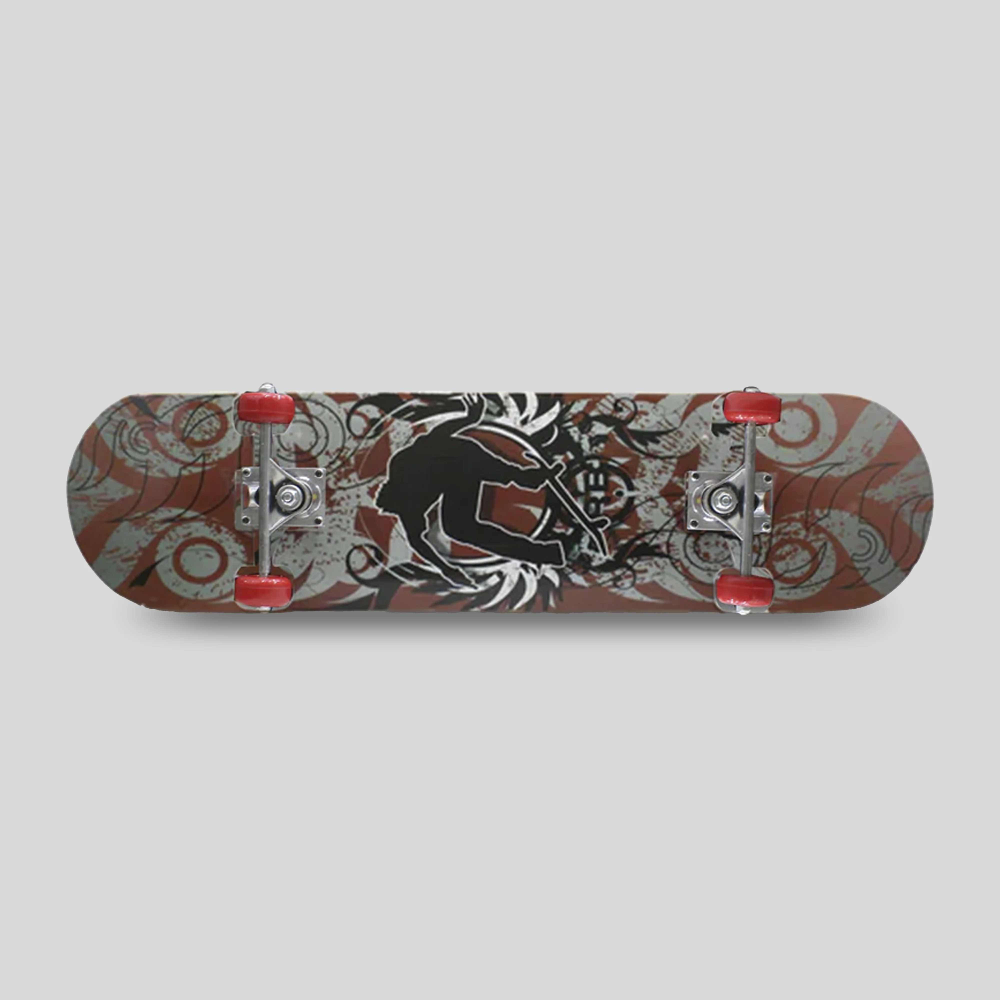
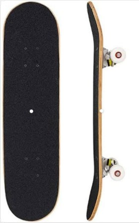
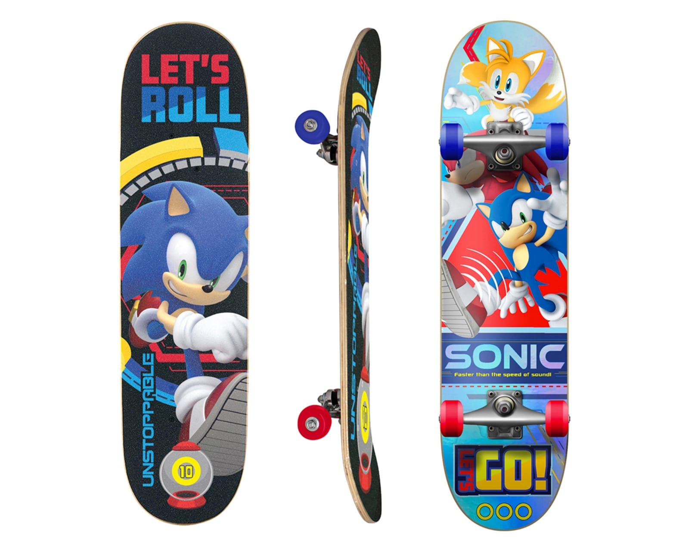

# 🚀 Práctica Guiada: Preparación y Evaluación de Imágenes para Visión Artificial

> **Nivel:** Básico – Principiante (Desde cero)  
> **Duración:** 2 horas  
> **Asignatura:** Soluciona problemas de Visión Artificial  
> **Especialidad:** Inteligencia Artificial  
> **Semestre:** 3º de Preparatoria  
> **Herramientas:** Python, Visual Studio Code, OpenCV y NumPy.
# PEDRO RAMSES MARTINEZ FUENTES
# RESULTADOS

# BICICLETAS
[text](img-original-0093/Patinetas)     
# PATNETAS
[text](leeme.md)     